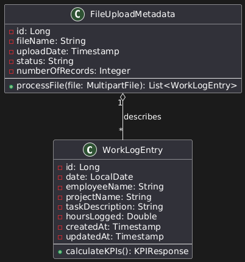
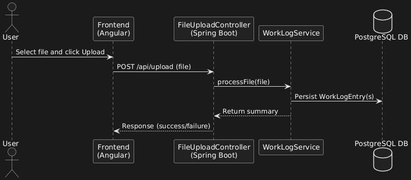

# FiberLog Pro

*Spring Boot backend that ingests daily work-log files (CSV or Excel), validates them, and serves KPIs and a PDF report for fiber-deployment teams.*


## Why

Field teams record daily work in spreadsheets. Turning those files into numbers (hours per project, hours per employee, how many rows are unusable) is manual and error-prone. FiberLog Pro takes the spreadsheet as is, rejects bad rows with row-level messages, stores the valid ones, and computes the indicators on demand. It was built as an end-of-studies (PFE) internship project.

## Features

- Upload a `.csv` or `.xlsx` work log through `POST /api/upload`. Files with another extension are rejected.
- Row validation (missing date, missing employee name, negative or missing hours) with a message per failing row.
- CRUD and paginated listing of work-log entries.
- KPI endpoint: total hours, average hours per employee, hours by project, most active employee, and counts of total, valid and invalid logs.
- PDF report of the KPIs and work-log lines, generated with Apache PDFBox.
- A global exception handler that maps errors to a consistent `ErrorDetails` response.
- Upload metadata (file name, status, record count) stored per upload.

## Architecture

Controller, service, repository, with DTOs between the web layer and the entities.

```text
fiberlog_pro/src/main/java/com/pfe/fiberlog_pro/
  controllers/      FileUploadController, WorkLogController, KPIController, ReportController
  services/         service interfaces
  implementations/  FileUploadServiceImpl (parsing + validation), WorkLogServiceImpl, KPIServiceImpl, ReportServiceImpl
  entities/         WorkLogEntry, FileUploadMetadata
  repositories/     Spring Data JPA repositories
  payloads/         DTOs (WorkLogDto, WorkLogRowDto, KPIResponseDto, ...)
  exceptions/       GlobalExceptionHandler
  config/           ModelMapper and logging configuration
```

Stack: Java 23, Spring Boot 3.4.2, Spring Data JPA, PostgreSQL, Apache POI 5.2.3 (Excel), Apache Commons CSV 1.9.0, Apache PDFBox 2.0.27, ModelMapper, Lombok, Actuator.

Design material (UML sources and images, UI mockups, Scrum artifacts) is in `assets/`:




The dashboard UI exists only as mockups in `assets/designs/`; this repository contains the backend.

## API

| Method | Path | Purpose |
| :--- | :--- | :--- |
| POST | `/api/upload` | Upload a CSV or Excel work log |
| GET | `/api/worklogs` | Paginated list of entries |
| GET / PUT / DELETE | `/api/worklogs/{id}` | Read, update, delete one entry |
| POST | `/api/worklogs` | Create one entry |
| GET | `/api/kpis` | KPI summary |
| GET | `/api/report/pdf` | PDF report |

### Input format

CSV (with a header row) or the first sheet of an Excel file, with these columns:

| Date | EmployeeName | ProjectName | TaskDescription | HoursLogged |
| :--- | :--- | :--- | :--- | :--- |
| 2025-02-10 | Employee A | Fiber Deployment | Installed fiber cables in District A | 8 |

## Run

Requirements: JDK 23 and a PostgreSQL database.

```bash
cd fiberlog_pro
# the datasource settings are in src/main/resources/application.properties
export DB_PASSWORD=<your local postgres password>
./mvnw spring-boot:run
```

The default datasource is `jdbc:postgresql://localhost:5432/fiberlog_pro` with user `postgres`; the password is read from `DB_PASSWORD`. The server listens on port 8080 and Hibernate creates or updates the schema (`ddl-auto=update`).

## Status and limits

No Excel/CSV fixtures or meaningful tests yet (only the Spring context test). The dashboard front end and authentication are not implemented.

## License

**Source-available, not open source.** Published under the
[PolyForm Strict License 1.0.0](LICENSE) so you can read the code, run it, and learn
from it for personal, research, or evaluation use.

You may **not** use it commercially, redistribute it, rebrand it, or publish modified
versions without written permission. Copyright (c) 2026 Yassine Krichen. All rights
not granted by the license are reserved.

For commercial licensing or collaboration: krichenyassine22@gmail.com
